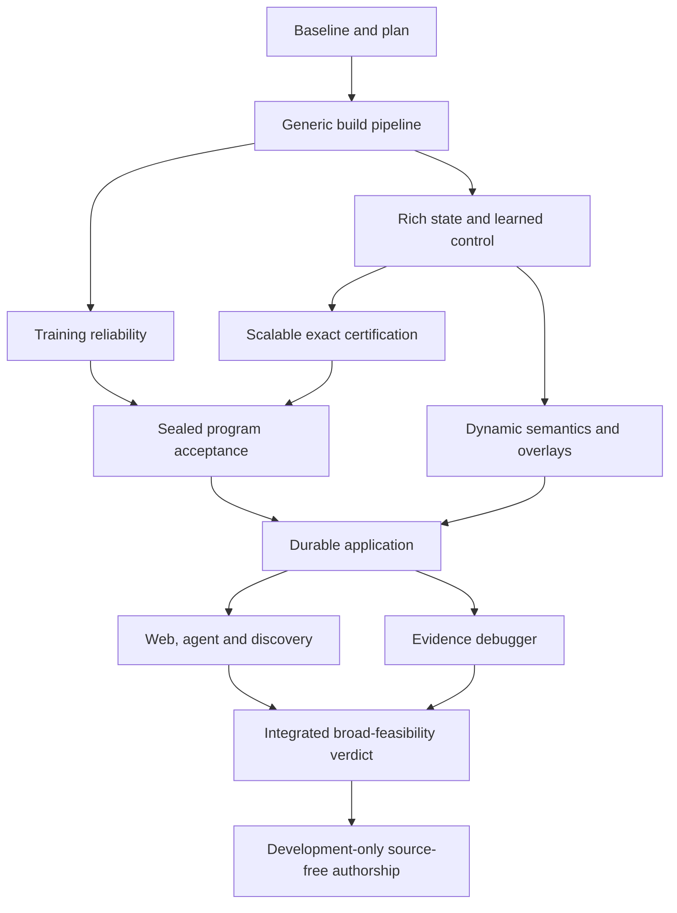

# PHLAME broad-feasibility plan

Date: 2026-10-26. Status: proposed execution plan with initial decision budgets.
G01 has passed for the scalar subset. G02 meets its initial scalar seed target;
its broader reliability requirements and all subsequent gates remain open.
See the [gate ledger](feasibility-gates.json) for current evidence.

[Gate ledger](feasibility-gates.json) · [First implementation slice](broad-feasibility-next-slice.md) ·
[Project brief](../PHLAM_Codex_Project_Brief.md) · [Runtime design](learned-runtime.md)

## What we are trying to establish

A developer can write a small class-based application in PHLAME, build it through
a general compiler/training pipeline, and deploy a frozen learned artifact that
executes useful application behavior under an exact semantic and effect boundary.
The same application supports conventional and agent interfaces with explicit
authority, and its behavior can be explained from real traces.

The existing experiments establish **bounded learned-execution feasibility**.
They do not establish broad compiler/application feasibility. Learning linear and
nonlinear transitions, source-free reload, independent modules, typed value
passing, finite certification and local atomic rollback all work in the scalar
family. Training remains fragile and certification enumerates a tiny domain.

We need two separate final verdicts:

1. **Broad compiler/application feasibility:** G01–G10 pass for the explicitly
   defined feasibility profile, including its language and systems obligations.
2. **Full-brief research feasibility:** that verdict plus R01, the development-only
   direct-authorship experiment. Same-representation execution/discovery is a
   required G08 hypothesis, not quietly replaced by a separate retrieval product.

Completing an experiment with a negative result answers a research question;
it does not turn the hypothesis into a pass. A failed mandatory gate leaves the
corresponding verdict failed or unresolved. Neither verdict means production
readiness, arbitrary-program support, PHP compatibility or universal verification.

## Baseline evidence and outstanding obligations

| Area | Evidence now | Still unproven |
|---|---|---|
| Learned execution | Frozen affine and nonlinear scalar transitions run without source | General compiler support across program families |
| Composition | Independent Counter/accumulator state and typed returns; local atomic publication | Richer state, internal control flow, concurrency and durable effects |
| Exact boundary | All finite primitive inputs checked at startup; zero warm contract arithmetic/predicates | Affordable verification without Cartesian enumeration |
| Training | Paired 4-unit models certify at seeds 7 and 404 | Reliable convergence across new programs and seeds |
| Language | Frontend plus restricted integer/object oracle | Arrays/strings execution, loops, cell aliases, dynamic names/calls and eval |
| Product | Research workers, contracts and observed traces | Manifest/lock build, deployment policy, shared interfaces and debugger |

The [paired-seed report](../experiments/paired-seed-sweep/run-0001/REPORT.md)
records 2/9 successes at width 4, including one previously known control, and
0/9 at width 2. Both successes preserve 594 primitive inputs, 224 supported
compositions and 526 domain rollbacks. These observations are a baseline, not an
acceptable general training-reliability claim. The two skipped dynamic-language
differential obligations remain open.

## Rules that apply to every gate

- The deployment artifact remains learned. Source/AST/IR support authoring,
  training, reference execution and proof construction; they must not become an
  undisclosed application interpreter in the deployed learned path.
- The runtime can bind exact identities, execute generic primitives, validate
  proofs, enforce effects and sequence transactions. It cannot hide a whole
  application implementation inside a supposedly generic primitive.
- Before each experiment, declare which transitions/control decisions are learned,
  which primitive operations are exact, and what the checker computes. Zero,
  shuffled and removed-weight ablations must remove the claimed learned
  contribution. Mere discovery/retrieval or constant opcode selection does not
  satisfy a claim of learned application control flow.
- Freeze before runtime validation. Execute the same frozen bytes in an
  independent process without source, compiler/oracle imports or training data.
  Expected outcomes belong to the external comparison harness, not inference.
- Compare against source execution and the strongest practical exact baseline
  appropriate to the task: current contract lookup, an exact implementation/IR
  interpreter, and specialized implementations where useful. Do not handicap
  lookup by duplicating computation it can reuse.
- At least one program per family has an independently stated behavioral fixture
  and mutation/metamorphic checks, so shared frontend/lowering bugs cannot pass
  solely because the source oracle and contract compiler agree with each other.
- Exact admitted behavior permits **zero incorrect accepted transitions**.
  Unknown, unsupported, exhausted or uncertifiable inputs fail closed. Measure
  correct coverage separately so rejecting everything cannot pass.
- Preserve atomic publication, owned state/outputs, ordered writes, versions and
  typed returns. Rejection exposes no staged application result. Debug disclosure
  is separately authorized and measured.
- Separate training/data generation, proof construction, signature/load, proof
  checking, inference/decoding, boundary, binding, commit, transport and storage
  costs. Report concrete and certified paths, clocked and unclocked measurements,
  memory, allocations, artifact/proof size and startup separately.
- Keep every candidate and failure. Select by predeclared semantic criteria,
  before timing. Separate development, selection and acceptance data. Use explicit
  `declared`, `inferred`, `verified` and `unknown` provenance labels.

## Execution and decision budgets

These are **initial proposed engineering thresholds**, not measured capabilities
or promises. G00 is complete as a planning baseline; G01 records its concrete
fixture/command manifest before implementation. Each later campaign locks its
programs, domains, recipe, seeds and budgets before running. Any amendment is
prospective, versioned and justified; an exhausted campaign stays on record.

- A research campaign tests at most two new training/representation strategies
  against an unchanged control, with five fixed fresh seeds: 11,23,37,53,71.
  Historical seed-404 fixtures are separate controls and do not improve the
  fresh-seed reliability count. No unbounded retry-until-success search.
- Initial per-candidate limits: 10 CPU minutes training, 10 CPU minutes proof
  construction, 4 GiB peak memory. Initial total build limit: two hours per
  program including oracle/data generation, all candidates and verification.
  Record host/toolchain and actual CPU/wall time. These limits can be revisited
  before a new campaign if measurements justify it.
- Reliability target: at least 4/5 fresh seeded fits certify **per required static
  acceptance program**, within those limits, across two clean repeated builds.
  Publish every fit; successful deterministic retry is not a substitute for this
  observed convergence requirement. Identical recipes/seeds must reproduce model
  bytes on the declared toolchain/inference target.
- Initial local-execution practicality target: accepted semantic operations have
  p95 at most 5 ms and at most 10× the fastest honestly equivalent exact baseline;
  runtime resident memory at most 1 GiB, deployed model/proof bundle at most
  25 MiB per component, cold verification/activation at most 5 seconds. Benchmark
  the declared operation size and target host. Transport and real I/O have
  separate budgets. A neural speedup is not required to establish feasibility.
- One failed campaign gets one evidence-led follow-up campaign with at most two
  declared interventions. Continued failure pauses dependent gates for a
  recorded design decision. Other independent specification work can continue;
  repeated failure must not disappear into endlessly smaller domains.

Budget failure is an honest feasibility result. Passing a tiny case does not
satisfy a larger gate whose mandatory cases were refused or excluded.

## G01 — General source-to-frozen-artifact pipeline

**Question:** can ordinary supported source pass through a reusable build process
without fixture-specific training commands or manually assembled artifacts?

Implement a minimal manifest/lock/training-plan schema, generic example
collection, bounded recipe selection, staging, freezing, build report and an
independent source-free runner. Start with existing Counter, rejecting accumulator
and saturating accumulator source. Rename classes/fields and reorder operations
to detect name-based special cases. Class purposes remain intent, never policy.

**Pass:** all three programs and their declared renaming/reordering variants
build and reload through one documented command/API; source-oracle and lookup
comparisons pass; a failed fit emits evidence and no deployable success marker;
all artifact roots, domains, lineage, defaults and ABI bindings are inspectable.
The runtime reconstructs its current finite certificate rather than accepting a
serialized `verified` boolean. Two clean builds reproduce normalized artifact
bytes. Existing experiments remain reproducible.

**Deliverable:** [the first slice](broad-feasibility-next-slice.md), source-free
bundle, command transcript and G01 verdict. This does not yet pass training
reliability or the broader language gates.

## G02 — Training reliability and representation selection

**Question:** can a generic bounded training procedure reliably produce exact
components on unfamiliar source, rather than occasionally finding one seed?

Separate recipe selection from acceptance. Instrument activations, gradients,
loss by output and exact integer errors, as in the existing diagnostics. Compare
at most two justified strategies per campaign: for example generic feature/
output normalization or separate transition/write-head training. Training may
use compiler facts and its training examples; no expected acceptance outputs,
hand-encoded application formulas or certificate-derived patch tables.

**Pass:** the fresh-seed target above on the initial three programs and subsequent
mandatory static families. Freeze the recipe before acceptance programs are
revealed. Data used for counterexample-guided training becomes training/selection
data; replace the acceptance set rather than continuing to call it held out.
A recipe may produce new weights for each new program; a single universal model
that executes unseen source without retraining is not required by this gate.

**Failure decision:** change the recorded training strategy/representation within
the bounded follow-up rule, or leave broad compilation unresolved. Neither a
single curated successful seed nor a lookup fallback passes this gate.

## G03 — Rich state, branching and internal control

**Question:** does the learned ABI extend beyond one scalar and host-supplied
schedules while retaining an understandable exact boundary?

Add typed multi-slot state, enums/booleans, bounded strings and arrays, multiple
arguments/results, instance creation/lifetime and multi-object operations in
small steps. Define exact cell/handle identity and effect frames before extending
models. Begin with exhaustively checkable miniature domains.

Use these six static families; each needs two development programs and one
acceptance program, for 18 source programs in the final corpus:

| Family | Mandatory behavior |
|---|---|
| Numerical branches | Piecewise operations with altered constants and branch order, not just renamed Counter |
| Inventory/reservation | Two or more dependent slots, accepted/rejected updates and frame preservation |
| Workflow records | Enum/status transitions plus numerical state and guarded calls |
| Bounded stack/queue | Array contents, length/index rules, reads, pushes/pops and failure behavior |
| Keyed records/text | Integer/string keys, exact string/JSON primitives and learned application decisions |
| Bounded iteration/reduction | Data-dependent branching and loop continuation over bounded collections |

**Pass:** each family has a source-free learned implementation with exact
primitive/result/write comparisons and the G02 reliability target. At least one
loop case must depend on learned continuation/control decisions. A host-supplied
unrolling, stored source CFG or mechanical iteration may be a baseline or an
explicit exact mode; it cannot establish learned control flow. Bounds, fuel,
primitive bindings and resource identities remain exact mechanisms.

The acceptance profile must exercise, not merely parse, at least four independent
state slots in one component, arrays up to length 8, string values up to 64 bytes,
16 live instances in a transaction/session, and a data-dependent loop up to 32
iterations. Individual programs need not use every feature, but the mandatory
corpus covers all these sizes, empty/boundary cases and budget failures. Exact
string/key/coercion semantics are specified before these tests are written.
Finite floats, inheritance and an unbounded standard library are outside this
first profile and must diagnose unsupported use explicitly; the required dynamic
features in G06 are not excluded by that choice.

The final multi-object workflow must compose independently trained components
through returns and owned state, with faults after multiple successful steps.
Do not replace the full cell/array design with scalar IDs that hide an entire
application implementation in a trusted adapter.

## G04 — Certification beyond Cartesian enumeration

**Question:** can exact checking remain affordable as the declared state space
grows, without re-executing the application for every warm call?

Compare the existing exhaustive certificate with a non-enumerating exact
certificate on at least three different families, including multi-slot and
control-flow cases. Define the trusted verifier/kernel, inference arithmetic,
rounding, overflow and target assumptions in an ADR before building the backend.

A candidate route is a learned fixed-point/rational numerical engine with
checkable regional proofs. Another is generic exact primitive execution with
learned control/term selection. Both are experiments, not predetermined wins.
Any changed inference engine/quantizer is versioned, frozen, ablated and verified
as the actual deployed engine. A real-number proof about a proxy network does
not certify float64 inference or rounded integer behavior.

**Pass:** exact certificates cover at least 1 billion declared primitive input
tuples in each of the three families within the build/size/startup budgets,
without visiting every tuple or retaining a next-state/output table. Publish
visited-case counts, proof size, proof-checking cost and trusted code inventory.
Mutation tests must reject altered weights, proof, domain, arithmetic engine,
ABI, bindings and rounding rules. Warm checking performs no duplicate
application relation evaluation and all admitted transitions are guaranteed by
the stated proof model. Random tests alone cannot pass this gate.

**Failure decision:** retain the finite result, bound the product explicitly and
withhold broad scalable-certification feasibility. A whole-application exact
interpreter labeled as a primitive or verifier does not resolve the hypothesis.

## G05 — Acceptance on programs the pipeline was not tuned for

**Question:** is this a compiler/training system rather than an experiment suite
with application-specific recipes?

Before G02/G03 acceptance, version and hash the 18-program corpus specification
and deterministic acceptance selection rule. The six acceptance programs must
include new source structure/branch/data-shape combinations, not just renamed
classes or a list of different saturation constants. Acceptance bodies and
expected scenarios are excluded from recipe-development feedback. Use a
reproducible reveal step and publish its commitment and audit history; if this
same development session has inspected/tuned against a program, it is not a
sealed acceptance program and must be replaced before the campaign.

The builder may generate training examples from each new program after reveal;
that is compilation. The compiler, model family, optimizer policy and selection
rules must already be frozen. Report separately: within-program test inputs,
new compositions, and compilation of previously uninspected programs. Do not
claim zero-shot execution of a new program.

**Pass:** all six required static acceptance programs build, certify and pass
source-free scenarios without compiler/recipe patches, meeting exactness,
coverage, G02 reliability and budgets. A rejected required program counts as
failed acceptance, not an excluded input. Preserve the first acceptance verdict;
a repair starts a new versioned campaign with a fresh acceptance set.

## G06 — Required dynamic-language semantics

**Question:** can the promised dynamic language coexist with frozen learned
applications without quietly dropping its difficult features?

Finish normative coercion/error rules, array value/copy behavior, reference-cell
aliasing and lifetime, variable variables, dynamic registered-call resolution,
loop bounds and caller-scope eval. Replace the two skipped differential tests
with real passing cases. The current language draft's unresolved array-element
alias/copy rules must be decided and tested, not papered over with a demo.

`eval` initially accepts statements in an ephemeral caller-cell overlay; persistent
class/tool definitions remain explicitly unsupported. It inherits and can only
narrow capabilities, includes parse/execute/nesting/memory budgets, cannot rerun
init, and cannot mutate base weights, contracts or public tool registration.

An explicit exact overlay is an allowed semantic mode. Count its execution,
checking and cost separately and label it in traces; it earns no learned
coverage credit. All six G03 static families must still pass through learned
execution. A source-language compatibility demo dominated by exact overlays
cannot satisfy the learned-substrate gate.

**Pass:** positive/negative oracle and deployment tests for aliases, array copies,
dynamic init denial, scoped names, nested eval, budget exhaustion, caller-visible
mutation, immutable base artifact and transaction-wide rollback. The canonical
indirect-variable/alias/eval scenario returns 12 in the caller scope. Invocation
needs no base source files; eval text is explicit runtime input, not a hidden
source implementation of the application.

## G07 — A durable application with mediated effects

**Question:** can learned decisions participate in ordinary application state and
effects, not just private in-memory numbers?

Build one Orders/Inventory/ledger-style application from the demonstrated static
families, with at least three independently trained components. Implement exact
storage adapters, versioned transactions and an outbox/idempotency protocol for
one recorded or local fake external service. Resolve storage/library selection
in an ADR; do not treat imports as authority. Keep local durable commit and
external delivery semantics distinct.

**Pass:** source-oracle/business-fixture and learned/lookup results match for
create/reserve/ship/refund-like workflows; tests include native refusal, domain
escape, stale state, concurrent conflicting callers, retries and process death.
Inject faults before commit, after durable commit/before dispatch and after
external receipt/before acknowledgement. Restart/replay produces no partial
local commit or duplicate externally applied effect under the declared adapter
protocol. Irreversible external actions are reconciled/idempotent, not claimed
to roll back magically. No real customer/payment systems are required.

## G08 — Shared web/agent surface and capability discovery

**Question:** can people and agents operate the same frozen application safely,
and does its learned representation contribute to discovery as the brief asks?

Implement manifest/lock dependency enforcement, deployment-principal policy,
authentication, version/resource/tenant-bound handles and generated
`describe/discover/inspect/invoke/observe` operations. Build a conventional web
client and an agent client over the same operation IDs and backend. All ranking
results are data; invocation independently checks authority and exact identity.

Discovery must test the same application representation (or a declared jointly
trained head over it) against lexical and explicit registry baselines on a
versioned query corpus with at least 50 selection and 50 held-out queries,
including ambiguous and unauthorized requests. Initial relevance target:
Recall@3 at least 0.90 on authorized held-out queries. Access-control negative
cases require zero unauthorized invocation or metadata disclosure. Report the
learned contribution and ablations; do not present a separate generic vector
index as this hypothesis succeeding. A successful ranking need not beat the
lexical baseline in speed, but must satisfy its declared relevance/authority
criteria. Failure leaves the full same-representation claim unresolved.

**Pass:** browser and agent produce matching application outcomes under the same
caller policy. Deny cross-tenant handles, wrong artifact versions, revoked
permissions, malicious descriptions, unlisted dependencies, trace disclosure and
confused-deputy attempts. Policy is fresh at invocation and commit. Use configured
private trust roots and key rotation fixtures; public research signing keys do
not pass this trust gate. A development authentication fixture is not a claim
of production penetration testing or OS isolation.

## G09 — Debugging from evidence

**Question:** can users understand and repair failures through source, learned
proposal, exact decision, state/version and effect provenance?

Provide inspectable structured traces, exact semantic breakpoints, authorized
observations, deterministic replay with recorded effects and a trace comparison
command. At least three seeded faults cover a wrong proposal, an application
contract/state error and an authorization/effect rejection.

**Pass:** each fault is localized with real source IDs and causal trace evidence,
replayed without live external effects, repaired in a new artifact version and
shown fixed on the same scenario plus regression cases. Explanations distinguish
observed, declared, inferred and unknown facts. Redaction prevents unauthorized
payload disclosure. An LLM can explain evidence but cannot invent events or
promote its own repair; an LLM is not required for the initial evidence-backed
explanation interface.

## G10 — Broad-feasibility acceptance and cost accounting

**Question:** do the pieces work together from a clean build and survive change?

Run the frozen acceptance suite on a clean checkout/build environment and a
source-free deployment environment. Include deployment, restart, artifact update,
rollback to the previous version, dependency mismatch and stale-handle tests.
Repeat on a second instance of the declared inference target. Cross-platform
support requires its own declared arithmetic/proof target and acceptance run.

**Pass:** all mandatory gate verdicts are passes; all 18 static source programs
and required dynamic/system scenarios meet their declared coverage and exactness
criteria; no required check remains skipped; reliability and practicality budgets
hold; every artifact/proof/ABI/policy version is inspectable; ablations still show
a real learned execution contribution. Publish an honest conventional-runtime
baseline, trusted-code inventory, cold/warm costs, exact-overlay share, failures
and remaining unsupported source shapes.

This closes broad compiler/application feasibility for that versioned profile.
It does not authorize real deployment or claim arbitrary-source support. Any
failed mandatory gate keeps the verdict open even if the showcase demo works.

## R01 — Direct authorship without source, in development only

This is the brief's final research track and is required before calling the
**entire brief's research feasibility** passed. It is not required to ship the
bounded compiler/application feasibility demonstration after G10.

Use a development-only interface to propose one genuinely new bounded capability
as a learned artifact/validated operation without supplying its source body.
Declarations of intent, parameters and constraints are allowed; the proposal
must contribute executable learned behavior, not just register an existing tool.
Require the same exact checks, clear authority and versioning, readable effect/
behavior reconstruction and before/after evidence. Prefer an auditable small
scope over unrestricted model self-editing.

**Pass:** the candidate freezes, certifies, runs source-free, satisfies its stated
reference/specification cases and negative authority tests, and produces a
reviewable semantic diff. Promotion requires the configured deployment principal;
normal application invocation cannot edit weights/contracts or grant authority.
No automatic production promotion is part of this experiment. If this fails,
record which hypothesis failed rather than treating source reconstruction as a
source-free authorship result.

## Dependency order and how to work through it

The corpus commitment precedes G02/G03 acceptance work even though G05 executes
after their development passes. Start reference-semantic specification early;
it is not permission to skip G02/G04 if a later demo looks attractive. This graph
shows independent work opportunities, not authorization to create extra chats,
spawn agents or schedule unattended jobs.

For each gate: lock its campaign, implement one bounded slice, run the specified
checks, publish artifacts and a pass/fail/inconclusive verdict, update the ledger,
then move to the next dependency. The first action is the G01 slice linked above.
Do not build the whole plan in one unreviewable change. No calendar deadline or
unattended execution is implied by this planning document.

## Report and verdict format

Each report records: hypothesis; fixed source corpus and domains; training/selection/
acceptance split; seeds and candidate budgets; learned/exact responsibility map;
actual runtime and proof engine; frozen roots and lineage; exactness/coverage;
source-free and negative tests; oracle/baseline/ablation results; startup/warm/
training/checker/effect costs; failures; limitations; and gate verdict.

Allowed ledger states are `complete` for the scoped baseline/plan,
`not_started`, `in_progress`, `passed`, `failed`, `inconclusive`, and `blocked`
with a named dependency. A report can finish while its feasibility verdict fails.
Progress claims must identify which of bounded execution, broad compiler/
application feasibility, or full-brief research feasibility they describe.
