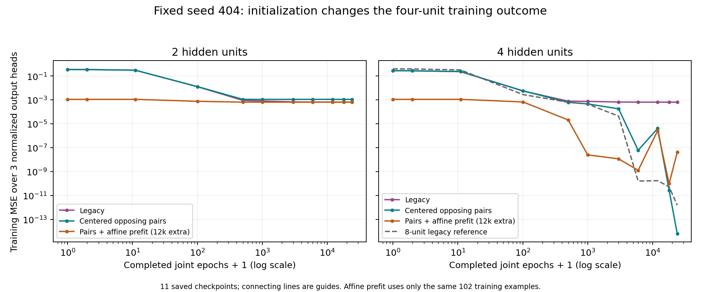

# PHLAME training dynamics and initialization: recorded run 0001

Recorded 2026-10-26. [Protocol and reproduction](../README.md) · [Configurations/checkpoints](selection.json) · [Independent audit](dynamics-analysis.json) · [Matched measurements](summary.json).

## Outcome

**A 4-unit, 47-parameter learned accumulator now fully certifies**, using centered, opposing random initial directions. It trains on the original 102 examples, then freezes, signs and reloads source-free. All **594 primitive transitions**, **224 supported compositions** and **526 domain rollbacks** preserve the source oracle’s exact decoded behavior. The initializer receives no source thresholds, branch labels, contract paths or nontraining targets.

This is 40.5% fewer parameters than the previously certified 8-unit model and establishes a four-unit realization of this finite task. All tested two-unit treatments still fail, so no minimum possible width is established. Runtime timing is noisy, with overlapping process ranges: there is no clear latency-improvement claim, and lookup retains the lowest median.

## What failed in legacy training

At seed 404, logged legacy 2-, 4- and 8-unit training reproduces the previous weights bit for bit. The low-width units are not initially all dead. Instead, useful nonlinear boundaries are lost or duplicated during optimization.

| Legacy model | Initial active training counts per unit / 102 | Final active counts | Final training MSE |
|---|---|---|---:|
| 2 units | 54, 23 | 96, 102 | 0.0006488392968 |
| 4 units | 54, 23, 23, 78 | 102, 96, 0, 102 | 0.000648839297 |
| 8 units | 54, 23, 23, 78, 102, 19, 85, 102 | 92, 92, 102, 101, 102, 85, 102, 101 | 1.549257628e-12 |

The 2-unit model ends with one mixed unit and one always-active unit. The latter is locally affine on all training samples and supplies no additional activation boundary there. The 4-unit model ends with one mixed unit, two always-active units and a dead unit; the dead unit has zero hidden gradient at logged checkpoints from epoch 3000 onward. Both plateau near MSE 0.000648839.

At argument zero for add, the legacy 2-unit mixed boundary intersects state near -16.517; the legacy 4-unit mixed boundary near +16.517. Each has only one useful saturation-side boundary and misses the other. This interpretation comes from final weights and activation patterns, not from branch annotations passed into training. More generally, counting mixed units alone is insufficient: two units can cover similar one-sided regions rather than learning both needed boundaries.

## Instrumentation and gradient audit

Eleven passive checkpoints capture completed joint epochs 0,1,10,100,500,1000,3000,6000,12000,18000,24000. Each stores copied weights, training MSE, per-unit preactivation extrema, activation counts by operation, hidden-gradient L2 norms and output-gradient L2 norm. Checkpoints are before the next update; the final gradient is computed without updating. Mutation tests prove that editing observer copies does not change trained weights.

An independent Python audit recomputes activation counts, losses and gradients for every checkpoint. Logged gradient norms match exactly in this environment. It also checks derivatives at legacy initialization by central finite differences, away from ReLU kinks:

| Legacy width | Parameters checked | Maximum absolute derivative discrepancy |
|---|---:|---:|
| w2-legacy | 31 | 1.939e-10 |
| w4-legacy | 47 | 1.814e-10 |
| w8-legacy | 79 | 2.78e-10 |

Finite-difference epsilon is 1e-6 and the failure tolerance is 1e-7. These checks support the logged optimization evidence and find no backpropagation discrepancy at the audited points; they are not a universal proof of the optimizer. Offline full-grid region accuracies are computed only after training and never fed back to updates or early stopping.

## Bounded initialization interventions

Two interventions were fixed after inspecting the legacy traces, at widths 2/4, seed 404 and 24,000 joint full-batch Adam epochs. A legacy 8-unit trace is a reference. No additional arms/seeds/budgets were searched after outcomes. Exploratory and recorded runs use identical settings and produce identical weights.

**paired-centered** zeroes hidden bias and own-operation offsets, retains random even-unit state/argument directions, and makes each odd direction their negative. The original random output heads are retained, with identical RNG draw order. Thus initial hyperplanes cross the input origin in opposing pairs. No saturation constant or preferred arithmetic direction is encoded; every layer remains trainable. Centering and pairing are a combined intervention, so their individual contributions are not separated here.

**paired-affine** uses the same geometry but first trains an affine model on the same 102 examples for **12,000 additional gradient-descent epochs**. Its base output weights initialize the network, and hidden-output coefficients start at zero. Joint Adam then trains every weight. This is additional optimization work, explicitly recorded in signed prefit lineage; it is not a free initialization or a runtime exact fallback. Its epoch-zero snapshot is after that prefit.

| Width / initialization | Training correct / 102 | Nontraining correct / 492 | Joint final MSE | Extra prefit epochs | Fully certified |
|---|---:|---:|---:|---:|---|
| 2 / legacy | 60 | 310 | 0.0006488393 | 0 | no |
| 2 / paired-centered | 40 | 200 | 0.0011085741 | 0 | no |
| 2 / paired-affine | 60 | 310 | 0.0006488393 | 12000 | no |
| 4 / legacy | 60 | 310 | 0.0006488393 | 0 | no |
| 4 / paired-centered | 102 | 492 | 6.3717153e-15 | 0 | yes |
| 4 / paired-affine | 102 | 492 | 4.1120718e-08 | 12000 | yes |
| 8 / legacy | 102 | 492 | 1.5492576e-12 | 0 | yes |

The centered 2-unit model becomes always-active on all training samples and returns to an affine fit. The affine-prefit 2-unit model retains mixed units but still specializes on one saturation side; it does not recover the missing side. Neither treatment establishes a two-unit success.

The centered 4-unit model retains two useful mixed add boundaries: each is active on 76/85 add examples, with argument-zero state intersections near +15.999996 and -15.999999. State and argument slopes align through training, without being prescribed. Both four-unit treatments pass the full integer grid. Selection takes the first certifying arm in declared order, paired-centered, before benchmarking; it also requires no extra prefit. Full-domain certification is selection data, not an independent architecture/initializer holdout.

The selected signed artifact is **3,786 bytes**, with **47 weights** (5×4 + 3×(5+4)). Maximum nontraining next-state/return score error is 0.000013880 integer units, below the 0.5 rounding threshold. The affine-prefit four-unit model has larger score error (0.262638 units) but also decodes every finite input correctly. Scores are approximate; exactness is the certified decoded integer behavior.

## Freeze, source-free certification and rollback

Every configuration freezes and reloads before runtime checking. Successful startups independently enumerate 594 accumulator and 330 Counter inputs against source-derived exact relations. Failed candidates stop at the first counterexample, get no partial certificate and execute zero certified transactions. Their full raw predictions and failed prefix work remain in the evidence. No source fallback, domain narrowing or certificate borrowed from the old model is allowed.

On all 750 supplied schedules, the passing four-unit models and the 8-unit reference each match all 224 supported source-oracle outcomes and roll back all 526 outside-domain schedules. Lookup has the same disposition in every trial. The source accepts all 750, so the scope cases are not native source rejections. Concrete checking of failed models admits only correct complete schedules and rejects wrong later proposals with all earlier state, writes and results discarded.

[Selected frozen model](trials/w4-paired-centered/accumulator.json), [runtime examples](trials/w4-paired-centered/example-results.json) and [real source events](common/oracle-traces.json) include upper/lower saturation, a threshold and failure after Counter and accumulator both stage writes. That last failure returns original states/versions with no published application results or writes. Debug source events intentionally expose attempted values separately.

The same generic predictor and transactional engine execute every model; initializer metadata does not switch inference behavior. Initialization mode and extra prefit count are signed provenance and validated on load; older artifacts still load. Contract specifications remain in the modules. Each worker process has no parser/compiler, source implementation or reference oracle import. Source independence does not imply an OS sandbox.

## Matched execution and separate checker work

The selected four-unit model, the historical frozen eight-unit model and lookup use one current profiling binary and one common frozen Counter. Its weights, contract and examples match the earlier control. Every process reloads signatures, rebuilds certificates, compares clocked/unclocked outcomes and validates all 750 cases against recorded source execution before measuring. All semantic hashes agree, including rejection reason/step, ordered writes and versions.

180 shuffled fresh-process measurements cover three variants × two boundaries × two clock modes × three workload groups × five repetitions. Each measures 100,000 transactions after validation, ten group warm-up passes and a GC, with GOMAXPROCS=1. Three separate diagnostic processes sample CPU/allocations over 1.5 million accepted certified transactions and are excluded from latency summaries.

| Accepted certified transactions, clocks off | Median process mean ns | Min | Max | Allocations/tx | Bytes/tx |
|---|---:|---:|---:|---:|---:|
| learned-w4-paired-centered | 2173.7 | 1635.0 | 3087.9 | 5.312 | 828.1 |
| learned-8-control | 2205.8 | 1862.8 | 2271.6 | 5.312 | 828.1 |
| lookup | 1973.8 | 1754.5 | 4303.6 | 5.312 | 828.1 |

Ranges overlap substantially and outliers are large. The smaller network has a slightly lower median than eight units, but this run establishes no clear latency improvement. Lookup has the lowest median. No timing run was repeated for a more favorable result. JSON, startup and full-batch retention are excluded; outer timings include counter aggregation and retaining the last result in a sink. No CPU pinning or confidence interval is claimed.

| Accepted certified transactions, phase clocks on | Proposal ns | Checker ns | Binding ns | Commit ns | Overhead ns | Total phase ns |
|---|---:|---:|---:|---:|---:|---:|
| learned-w4-paired-centered | 603.8 | 485.2 | 355.0 | 172.8 | 1864.0 | 3484.1 |
| learned-8-control | 752.8 | 509.9 | 370.6 | 187.5 | 1968.2 | 3789.3 |
| lookup | 593.0 | 490.0 | 374.6 | 179.5 | 1927.4 | 3564.5 |

Phase cells are medians of process means and need not sum. Full mixed/rejected, concrete and clocked measurements are retained. Exact checker counts for 100,000 accepted transactions are identical across variants and clock modes:

| Checker work | Concrete | Certified |
|---|---:|---:|
| Integer arithmetic | 1,472,742 | 0 |
| Predicates | 1,591,054 | 0 |
| Expressions | 7,843,650 | 0 |
| Output comparisons | 1,387,500 | 0 |
| Binding checks | 462,500 | 462,500 |
| Frame checks | 200,000 | 200,000 |
| Domain checks | 462,500 | 925,000 |
| Certificate uses | 0 | 462,500 |

Certified lookup executes relation arithmetic/predicates as separately counted application work. Concrete lookup coalesces application evaluation with checking. Learned proposal math, rounding and numerical sanity checks remain proposal work. Zero warm contract evaluation is not free boundary enforcement. Successful startup still performs 5,949 integer contract operations, 7,185 predicates and 2,772 comparisons over 924 inputs; load/build costs remain outside the warm loop and are recorded per process.

## Reproducibility and limits

All seven configurations retain signed models, raw scores, checkpoint histories, source/lookup comparisons and example outcomes. Byte-identical source observations, training data, requests and source traces live once under common/, with per-trial digest references. The independent audit and static loss figure are derived after training and timing.

| Evidence | SHA-256 |
|---|---|
| Selected four-unit module | `aa4a59ecf32103fc5376eda9de69b5f475dc1f98c7ac0c9ca7ab69d3b6fe2f8e` |
| Shared training samples | `99c5e078f2c4d6ddcda49105f67d2afb66dee6ce4ceedd25190e667078b69124` |
| Primitive source observations | `e60409c995fa4000adabaec91ba64fe76859d40c81236f4969bd8192cc5240e2` |
| Selected raw predictions | `5314e626f809702bf1c77ee2fbda7d23da18e029a421734548b96abe5ba647c6` |
| Profiling binary | `1d06eaf5356f1317776f9244b40e477569bece7995105c63dac984da144b6df5` |
| Common Counter module | `51d2bf0bf344142e094d64b25b2c28151589c0e1348b6e251aa420162e0918a3` |

Toolchain: go version go1.26.4 linux/amd64. Source/implementation hashes, binary digests, startup costs and every failed artifact are in selection.json and per-trial reports. Builds use -trimpath -buildvcs=false. Research keys remain publicly reproducible fixtures; process-local certification does not establish production identities or permissions. Older frozen artifacts and reports remain unchanged.

go test -count=1 ./... and go vet ./... passed. Added tests cover passive observer ownership, treatment certification and signed prefit/initializer metadata. The selected four-unit model runs the existing exhaustive source-oracle, composition, zero/shuffle/nonlinear-removal ablation, source-free reload and atomic rollback tests. Historical raw-score, zero-allocation prediction, seed, frame/binding, tamper and clock-equivalence tests remain. Two pre-existing dynamic-language differential tests remain skipped.

This is an investigation of seed 404 and a combined geometry intervention, not an explanation of every failed seed. It demonstrates that four units can satisfy this finite task under a changed initialization; it does not establish minimum capacity, universal optimizer correctness, generalization outside the integer grid or learned planning. The affine treatment has an explicitly larger total training budget. All nontraining inputs are certification/selection data, not an independent initializer-selection holdout.
